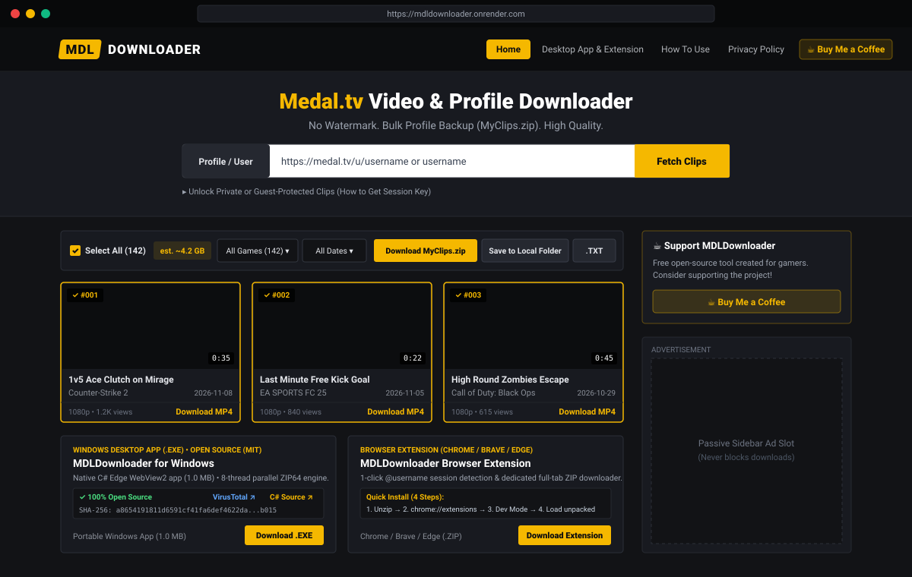
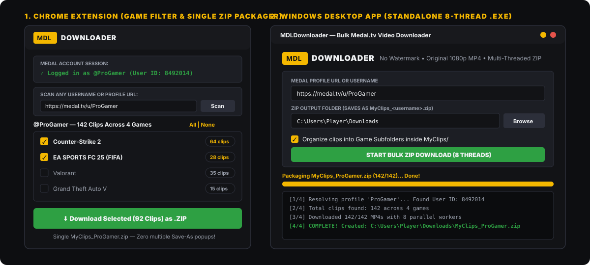

<div align="center">

# 🎮 `[MDL]` DOWNLOADER

### Bulk Medal.tv Video Downloader — No Watermark • Original 1080p MP4 • Game Subfolder `.ZIP`

[](#)
[](#2-chrome-extension-in-popup-game-selector)
[](#3-windows-desktop-app-standalone-exe)
[](#license)

**MDLDownloader** is a complete 3-in-1 open-source toolkit to back up and bulk-download your gaming clips from **Medal.tv** in original full-HD quality without watermarks, automatically sorted into game folders inside a single `MyClips_<username>.zip` archive.

[🌐 Web App](#1-web-application-zero-dependency-nodejs) • [🧩 Chrome Extension](#2-chrome-extension-in-popup-game-selector) • [💻 Windows Desktop `.EXE`](#3-windows-desktop-app-standalone-exe) • [🚀 1-Click Cloud Deploy](#deploy-your-own-instance-free)

</div>

---

## 🖼️ Web Application Preview



---

## 🧩 Chrome Extension & Desktop `.EXE` Preview



---

## ✨ Why MDLDownloader?

Gamers often accumulate **hundreds of clips** across multiple games (Counter-Strike 2, Valorant, EA SPORTS FC / FIFA, GTA V, League of Legends, etc.). Downloading them one by one through a browser takes hours, and guest-protected clips often fail to download without a valid session.

**MDLDownloader** solves this with **three tools in one repository**:

| Platform | Best For | Key Features |
| :--- | :--- | :--- |
| 🌐 **Web App** (`web/`) | Instant browser access on any OS | Paste username/URL, filter by game, download single `MyClips_<user>.zip` or save directly to a local folder via File System Access API. |
| 🧩 **Chrome Extension** (`chrome-extension/`) | 1-click session detection + Game checklist | Automatically detects your logged-in Medal account (or lets you scan any public username), displays clip counts per game with checkboxes, and downloads selected games as a single `.ZIP` right inside the popup. |
| 💻 **Desktop App** (`desktop-app/`) | Huge libraries (200–2,000+ clips) | Standalone Windows `MDLDownloader.exe` with **8 parallel download threads**, automatic `MyClips/<Game>/` subfolder organization, and clean `.ZIP` packaging. |

---

## 🛠️ How It Works & Features

- **Original Direct MP4 Streams:** Fetches the highest available resolution (`contentUrl1080p` -> `720p` -> `480p` -> `source`) directly from Medal's CDN without re-encoding or adding watermarks.
- **Game Subfolder Organization:** Automatically groups clips by category (e.g., `MyClips/Counter-Strike 2/Ace_Clutch_12345.mp4`, `MyClips/FIFA/Last_Minute_Goal.mp4`).
- **Private & Guest-Protected Clip Support:** Supports optional `X-Authentication` (`userId,key`) tokens so you can download your own guest-protected clips that normally return a `privacy-protected-guest` placeholder.
- **Zero Multiple Save-As Popups:** Both the Web App and Chrome Extension bundle `JSZip` to package all selected clips into a **single `MyClips_<username>.zip`**, preventing browser tab crashes or hundreds of file-save prompts.
- **100% Privacy-First:** Runs locally or via stateless proxy streams. Session tokens are never stored, logged, or transmitted to third parties.

---

## 🚀 Quick Start Guide

### 1. Web Application (Zero-Dependency Node.js)

The web application requires **only Node.js (v18+)** — no external `npm install` packages are needed!

```bash
# Clone the repository
git clone https://github.com/YOUR_USERNAME/MDLDownloader.git
cd MDLDownloader

# Start the web server
npm start
```

Open **`http://localhost:3000`** in your browser.

- **Public Clips:** Enter any Medal username or `https://medal.tv/u/<username>` and click **Download**.
- **Protected / Private Clips:** Click **"Need to download private/guest-protected clips?"**, follow the 3-step `allow pasting` console snippet on `medal.tv` to copy your `userId,key`, and paste it into the session box.

---

### 2. Chrome Extension (In-Popup Game Selector)

No web server needed — works directly inside Chrome, Brave, Edge, or Opera:

1. Download [`web/public/downloads/MDLDownloader-Chrome-Extension.zip`](./web/public/downloads/MDLDownloader-Chrome-Extension.zip) (or use the [`chrome-extension/`](./chrome-extension) folder directly).
2. Open Chrome/Brave and navigate to `chrome://extensions/`.
3. Enable **Developer mode** in the top-right corner.
4. Click **Load unpacked** and select the `chrome-extension` folder.
5. Click the **MDLDownloader** icon in your toolbar:
   - If you are logged into `medal.tv`, it automatically loads your account and lists all your games with clip counts.
   - Or type **any username / profile URL** in the search box and click **Scan**.
   - Check the games you want (e.g., ✅ *FIFA (8 clips)* + ✅ *Counter-Strike 2 (20 clips)*) and click **Download Selected as .ZIP**.

---

### 3. Windows Desktop App (Standalone `.EXE`)

For maximum speed on large clip libraries:

1. Download and run **[`desktop-app/MDLDownloader.exe`](./desktop-app/MDLDownloader.exe)** (or download it directly from the Web App homepage).
2. Enter your Medal Profile URL or Username.
3. (Optional) Paste your `userId,key` session token if your clips are guest-protected.
4. Choose your output directory (defaults to `Downloads`) and click **START BULK ZIP DOWNLOAD (8 THREADS)**.
5. Your clips will be downloaded in parallel and packaged into `Downloads/MyClips_<username>.zip`.

> **Want to build the `.EXE` from source yourself?**
> ```bash
> cd desktop-app
> pip install pyinstaller
> pyinstaller --onefile --windowed --name "MDLDownloader" MDLDownloader_Desktop.py
> ```

---

## ☁️ Deploy Your Own Instance (Free)

This repository includes a [`render.yaml`](./render.yaml) blueprint and [`package.json`](./package.json) for instant cloud deployment on **Render**, **Railway**, or **Fly.io**:

1. Push this repository to your GitHub account.
2. Go to [Render.com](https://render.com) -> **New Web Service** -> Connect your GitHub repository.
3. Render will automatically detect `npm start` (`node web/server.js`) and deploy your site live with free HTTPS.

---

## 📂 Project Structure

```text
MDLDownloader/
├── assets/
│   ├── web-preview.svg               # Web UI preview graphic
│   └── extension-preview.svg         # Chrome Extension & Desktop .EXE preview
├── chrome-extension/                 # Standalone Manifest V3 Chrome Extension (v1.3)
│   ├── manifest.json                 # Extension permissions & config
│   ├── popup.html                    # Dark & gold game-checklist popup UI
│   ├── popup.js                      # Auto-session detector, scanner & JSZip packager
│   └── jszip.min.js                  # Local JSZip library for single-file .ZIP creation
├── desktop-app/                      # Multi-threaded Windows Desktop Application
│   ├── MDLDownloader_Desktop.py      # Python/Tkinter source code (8-thread downloader)
│   └── MDLDownloader.exe             # Standalone compiled Windows executable
├── web/                              # TikWM-style Web Application
│   ├── server.js                     # Zero-dependency Node.js server & CDN redirect proxy
│   └── public/
│       ├── index.html                # Main UI, Console Guide, Tool Cards & Privacy Policy
│       ├── app.js                    # Client-side scanner, filter & ZIP/Folder downloader
│       └── downloads/                # Direct downloadable .EXE & Extension .ZIP packages
├── package.json                      # Node.js entry point for cloud hosting
├── render.yaml                       # 1-click Render.com free deployment config
└── README.md                         # Project documentation
```

---

## 🔒 Privacy & Legal Disclaimer

- **No Personal Data Collected:** MDLDownloader does not store, log, or transmit user credentials, session tokens, or IP addresses to any database.
- **Independent Tool:** MDLDownloader is an independent archiving utility created for users to back up their own gaming clips and is **not** affiliated with, endorsed by, or connected to Medal B.V. (`medal.tv`).

---

## 📄 License

Distributed under the **MIT License**. Free to use, modify, and self-host.
